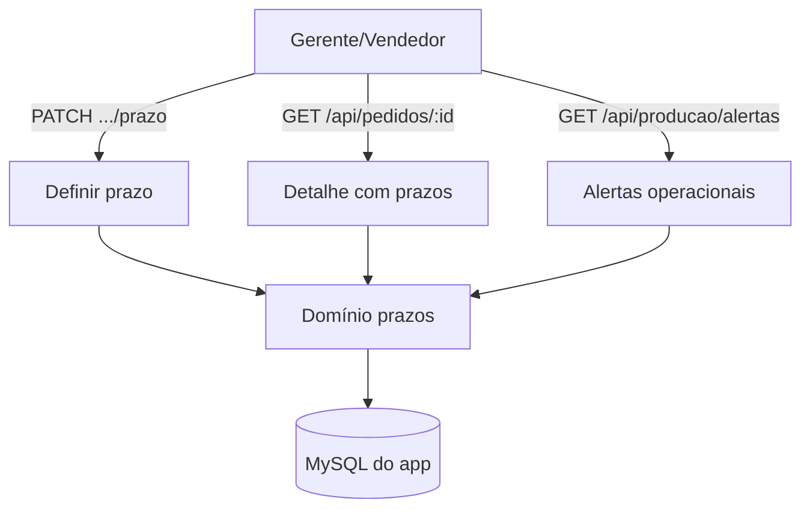

# Prazos e Alertas — Design

**Spec**: `.specs/features/prazos-e-alertas/spec.md`
**Status**: Active (AD-009 revisado e implementado em 2026-10-22)

---

## Architecture Overview

Domínio em `src/modules/prazos/` (prazo, atraso, alertas) com porta `PrazosRepository` e adapter Prisma. Prazo por item (`OrderItem.deadlineAt`) e por atividade (`Activity.deadlineAt`), independentes. O status de atraso é derivado; não há novo campo.

O **modelo de leitura** faz parte do desenho: `GET /api/pedidos/[orderId]` devolve `deadlineAt` (item) e `activityDeadlineAt` (setor), para a interface hidratar o formulário e o badge a partir do banco. O prazo é uma data civil persistida no fim do dia em `America/Sao_Paulo`.

---

## Code Reuse Analysis

| Component | Location | How to Use |
| --- | --- | --- |
| Contexto de auth | `src/shared/http/auth-context.ts`, `autorizacao.ts` | Proteger as rotas; ação `definir_prazo`. |
| Matriz de permissões | `src/modules/usuarios/permissoes.ts` | Já permite `definir_prazo` a gerente e vendedor; leitura por `consultar_pedidos`. |
| Cliente Prisma | `src/shared/db/prisma.ts` | Repositório. |
| Schema Prisma | `prisma/schema.prisma` | `OrderItem.deadlineAt`, `Activity.deadlineAt`, `Activity.status`. |
| Detalhe do pedido | `src/modules/indicadores/consulta-pedidos.ts` + adapter | Expor `deadlineAt` e `activityDeadlineAt` (AD-009). |
| Helper de dia civil | `src/shared/time/dia-do-periodo.ts`, `dia-civil.ts` | Fim do dia em São Paulo e formatação sem deslocamento. |
| Detalhe na UI | `src/shared/ui/pedido-detalhe.tsx` | Hidratar input/badge da API; leitura do prazo do setor. |

---

## Components

### `prazo`

- **Purpose**: Definir e validar o prazo de item e de atividade.
- **Location**: `src/modules/prazos/prazo.ts`
- **Interfaces**: `definirPrazoItem({ itemId, prazo })`, `definirPrazoAtividade({ atividadeId, prazo })`; porta `PrazosRepository`.

### `atraso`

- **Purpose**: Calcular o status de prazo.
- **Location**: `src/modules/prazos/atraso.ts`
- **Interfaces**: `calcularStatusPrazo({ prazo, concluido, agora }): 'SEM_PRAZO' | 'EM_DIA' | 'ATRASADO'`.

### `alertas`

- **Purpose**: Listar atividades atrasadas.
- **Location**: `src/modules/prazos/alertas.ts`
- **Interfaces**: `listarAtividadesAtrasadas(agora)`.

### Adapter e rotas

- `src/modules/prazos/adapters/prisma-prazos-repository.ts`.
- `src/app/api/pedidos/itens/[itemId]/prazo/route.ts` — `PATCH`.
- `src/app/api/producao/atividades/[id]/prazo/route.ts` — `PATCH`.
- `src/app/api/producao/alertas/route.ts` — `GET`.

---

## Data Models

Sem mudança de schema. Usa `OrderItem.deadlineAt`, `Activity.deadlineAt`, `Activity.status`.

Regra de status: `SEM_PRAZO` quando não há data; `ATRASADO` quando `agora > prazo` e não concluído; caso contrário `EM_DIA`.

**Data civil (AD-009/D2):** o texto aceito é `YYYY-MM-DD` e é convertido para o último milissegundo do dia em `America/Sao_Paulo` (`fimDoDiaNoFuso`). Exemplo: `2026-02-01` → `2026-02-02T02:59:59.999Z`. Isso faz `agora > prazo` significar “o dia do prazo terminou”, mantendo as comparações de `atraso.ts` e `pcp.ts`. A exibição usa `formatarDiaCivil`/`diaCivilParaInput`, sempre com o fuso explícito.

**Leitura:** `EspecificacaoItem` e `ItemDetalhado` ganham `deadlineAt` e `activityDeadlineAt`; o adapter seleciona os dois campos. Nenhum campo derivado persistido. O prazo operacional é exibido apenas para leitura (D5).

---

## Error Handling Strategy

| Error Scenario | Handling | User Impact |
| --- | --- | --- |
| Sem perfil para definir prazo | `403` | Sem permissão. |
| Data inválida | `400` | Validação. |
| Item/atividade inexistente | `404` | Não encontrado. |
| Sem sessão | `401` | Precisa logar. |

---

## Risks & Concerns

| Concern | Location | Impact | Mitigation |
| --- | --- | --- | --- |
| Fuso horário do prazo | datas | Atraso ou dia incorreto | Data civil ancorada no fim do dia em `America/Sao_Paulo`; exibição com fuso explícito. |
| Prazo por item e por setor | `deadlineAt` duplicado | Ambiguidade | Item = entrega; atividade = setor; sem herança. |
| Dados antigos em meia-noite UTC | `pedidos_itens` / `atividades` | Prazo exibido um dia antes | Sem conversão automática (D6). Em demonstração, re-salvar pela interface; dados reais exigem autorização. |
| Sem alertas ativos | RF012 | Sem notificação | Aqui é consulta; notificação fica fora do escopo. |
| Alerta comercial ausente | `indicadores/alertas` | “Atrasados” é operacional | D4: não implementar até a AD-011; não confundir os níveis. |

---

## Tech Decisions

| Decision | Choice | Rationale |
| --- | --- | --- |
| Status derivado | `SEM_PRAZO`/`EM_DIA`/`ATRASADO` | Sem novo campo. |
| Atraso | Só com prazo e não concluído | `docs/regras-negocio.md`. |
| Permissão | `definir_prazo` (gerente, vendedor); leitura `consultar_pedidos` | Matriz existente (D9). |
| Alertas | Consulta de atividades atrasadas | RF012; alerta comercial adiado (D4). |
| Data civil | `YYYY-MM-DD` estrito, fim do dia em SP | AD-009/D2. |
| Leitura do detalhe | `deadlineAt` + `activityDeadlineAt` | Sem estado local efêmero. |
| Prazo operacional na UI | Somente leitura | AD-009/D5. |
