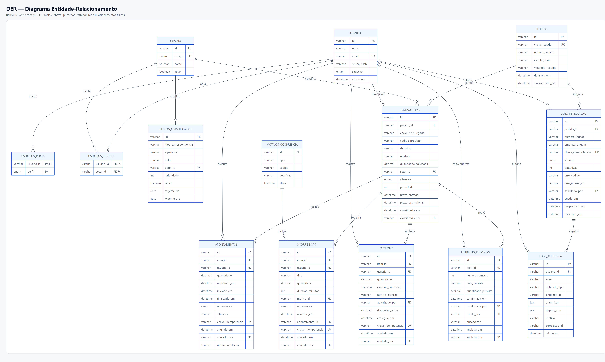

# Evolução do banco de dados — 31/10/2026

**Resultado**: o banco saiu de **17 tabelas** para **14 tabelas**, com **todos os nomes físicos em português**, sem perder funcionalidades da aplicação.
**Banco novo**: `3e_operacoes_v2` (MySQL 8.4, mesma instância RDS).
**Banco antigo preservado**: `3e_operacoes`.
**Backup**: `3e_operacoes_backup_20261031`.
**Aplicação**: mesma base de código, com adaptadores reescritos e apenas uma mudança visível ao usuário (anulação de remessa com motivo).

---

## 1. Resumo executivo

| Antes | Depois |
| --- | --- |
| 17 tabelas | **14 tabelas** |
| Colunas em inglês | **Colunas em português** |
| `atividades` como tabela | **Absorvida em `pedidos_itens`** (1:1) |
| `mapeamentos_categoria_setor` + `regras_produto_setor` | **`regras_classificacao`** |
| `eventos_job_integracao` | **Absorvida em `logs_auditoria`** |
| `execucoes` | **`apontamentos`** (com início/fim/observação/anulação) |
| `remessas_programadas` | **`entregas_previstas`** (com autores e anulação) |
| Sem views | **5 views de leitura** |

**O que não mudou**: telas, menus, permissões, fluxos de importação, classificação, fila, execução, ocorrências, entregas, prazos, painel, impressão e auditoria. A aplicação continua funcionando com os mesmos contratos externos; os IDs de atividade agora são os IDs do item.

**Validação**: 1.182 testes verdes, typecheck/lint/build OK, validações de UI 15/15 e 16/16 em produção, e ETL com contagens e somas conferidas (0 órfãos).

---

## 2. O que mudou no banco

### 2.1 Tabelas que deixaram de existir

| Tabela removida | Destino |
| --- | --- |
| `atividades` | `pedidos_itens` (`setor_id`, `situacao`, `prioridade`, `prazo_operacional`, `classificado_em`, `classificado_por`) |
| `mapeamentos_categoria_setor` | `regras_classificacao` (`tipo_correspondencia='CATEGORIA'`, `operador='IGUAL'`) |
| `regras_produto_setor` | `regras_classificacao` (`CODIGO_PRODUTO` e `DESCRICAO`, uma linha para cada) |
| `eventos_job_integracao` | `logs_auditoria` (`entidade_tipo='JobIntegracao'`; view `vw_eventos_job_integracao`) |
| `execucoes` | `apontamentos` (renomeada e enriquecida) |
| `remessas_programadas` | `entregas_previstas` (renomeada e enriquecida) |

### 2.2 As 14 tabelas

| # | Tabela | Papel |
| --- | --- | --- |
| 1 | `usuarios` | Identidade, senha (`senha_hash`) e situação (`situacao`) |
| 2 | `usuarios_perfis` | N:N usuário × perfil (`perfil`) |
| 3 | `usuarios_setores` | N:N usuário × setor |
| 4 | `setores` | Cadastro de setores |
| 5 | `regras_classificacao` | Regras de categoria/código/descrição → setor |
| 6 | `pedidos` | Cabeçalho importado |
| 7 | `pedidos_itens` | Item comercial + operação (setor, situação, prioridade, prazos) |
| 8 | `apontamentos` | Execução/separação parcial, com autoria e anulação |
| 9 | `ocorrencias` | Perda, refugo, indisponibilidade, pausa, parada, defeito |
| 10 | `motivos_ocorrencia` | Catálogo de motivos |
| 11 | `entregas` | Entrega realizada, exceção e anulação |
| 12 | `entregas_previstas` | Previsão de entrega (remessa), confirmação e anulação |
| 13 | `jobs_integracao` | Job de importação e solicitante |
| 14 | `logs_auditoria` | Auditoria e eventos de job |

### 2.3 Views

| View | Uso |
| --- | --- |
| `vw_atividades` | Compatibilidade de leitura da antiga “atividade” (id = item) |
| `vw_item_saldos` | Solicitado, executado, entregue, disponível e pendente por item |
| `vw_fila_setor` | Fila operacional por setor |
| `vw_pedido_resumo` | Contagens por pedido (sem somar unidades diferentes) |
| `vw_eventos_job_integracao` | Linha do tempo do job a partir da auditoria |

### 2.4 Diagramas

| Diagrama | Arquivo |
| --- | --- |
| **DER** — entidades, colunas, PK/FK e relacionamentos físicos | [`diagramas/der-banco-pt-v2.png`](diagramas/der-banco-pt-v2.png) |
| **MER** — visão conceitual das entidades e cardinalidades | [`diagramas/mer-banco-pt-v2.png`](diagramas/mer-banco-pt-v2.png) |
| **Classes** — classes de persistência, atributos e multiplicidades | [`diagramas/classes-banco-pt-v2.png`](diagramas/classes-banco-pt-v2.png) |



Fontes editáveis: [`der`](diagramas/der-banco-pt-v2.mmd), [`mer`](diagramas/mer-banco-pt-v2.mmd) e [`classes`](diagramas/classes-banco-pt-v2.mmd).
Para regerar: `node scripts/render-diagramas-banco.mjs`.

---

## 3. Por que 14 tabelas (e não 19)

O modelo proposto em `banco_novo_marcelo` tem 19 tabelas porque acrescenta `perfil`, `unidade_medida`, `produto` e `divergencia`. Nesta evolução, priorizamos **reduzir** tabelas e manter a aplicação estável:

- `perfil` não foi criado: o enum `RoleCode` + `usuarios_perfis` continua atendendo à matriz de permissões. Se a avaliação exigir a tabela, ela entra como **+1** (15).
- `unidade_medida` não foi criado: a unidade continua texto validado pela aplicação. Se for necessário normalizar, entra como **+1** (16).
- `produto` não foi criado: o item guarda código/descrição do legado.
- `divergencia` não foi criado: as divergências continuam em `logs_auditoria` (`UNIT_DIVERGENCE`, `QUANTITY_DIVERGENCE`) e podem ser expostas por view.

**O que não fundimos de propósito**:

| Não fundir | Motivo |
| --- | --- |
| `entregas` + `entregas_previstas` | Previsto × realizado; juntar criaria uma tabela com muitos campos nulos. |
| `usuarios_perfis` + `usuarios_setores` | Viraria tabela polimórfica sem FK real. |
| `motivos_ocorrencia` + outros cadastros | Catálogo genérico piora a clareza. |
| `apontamentos` + `ocorrencias` | Fatos distintos; juntar prejudica relatórios e regras. |

---

## 4. Migração e ETL

- **Baseline**: `prisma/migrations/20261031000000_banco_pt_v2/migration.sql` cria as 14 tabelas, as 5 views, os CHECKs e os índices.
- **Migrations antigas**: movidas para `prisma/migrations_legado/` (histórico local; o Git mantém a versão anterior no commit `192e53b`).
- **Backup**: `3e_operacoes_backup_20261031` (clone completo do banco antigo).
- **ETL**: `scripts/etl-banco-pt.mjs` lê o banco antigo e grava no novo, preservando IDs, datas, autoria, valores e histórico.
- **Regras de transformação**:
  - `atividades` → campos operacionais do item.
  - `execucoes` → `apontamentos` (chave `legado:execucao:<id>`).
  - `ocorrencias` → item + motivo (chave `legado:ocorrencia:<id>`).
  - `entregas` → item + exceção (chave `legado:entrega:<id>`).
  - `remessas_programadas` → `entregas_previstas`.
  - `mapeamentos` + `regras_produto` → `regras_classificacao` (28 regras de produto = 14 × 2 tipos).
  - `eventos_job_integracao` → `logs_auditoria` (101 eventos).
  - `jobs_integracao` → `empresa_origem` e `solicitado_por` (auditoria `IMPORT_REQUESTED` quando existir).

### Conferência de produção

| Item | Antes | Depois |
| --- | --- | --- |
| Pedidos | 10 | 10 |
| Itens | 63 | 63 |
| Itens com setor | 14 atividades | 14 itens |
| Apontamentos | 16 execuções | 16 |
| Soma executada | 206 | 206 |
| Ocorrências | 14 | 14 |
| Entregas | 9 | 9 |
| Soma entregue | 145 | 145 |
| Remessas | 3 | 3 |
| Jobs | 15 | 15 |
| Eventos + logs | 120 | 120 |
| Usuários | 8 | 8 |
| Motivos | 9 | 9 |
| Perfis | 8 | 8 |
| Vínculos usuário-setor | 9 | 9 |
| Órfãos de FK | — | **0** |

---

## 5. O que muda para o usuário

### 5.1 Mudança visível: anulação de remessa

- O botão **“Excluir remessa”** passou a **“Anular remessa”**.
- A confirmação ganhou o campo **“Motivo da anulação (opcional)”**.
- A remessa **não é mais apagada**: fica com `anulada_em`, `anulada_por` e `motivo_anulacao`, preservada para auditoria.
- A lista de remessas continua ocultando as anuladas.
- Entregas e saldos continuam **inalterados**.
- A API `DELETE /api/pedidos/remessas/[id]` aceita `?motivo=...` (ou corpo JSON) e continua funcionando sem motivo (usa “Removida pelo usuário”).

### 5.2 Mudança interna com efeito em links

- A “atividade” deixou de ser uma tabela; o **ID da atividade agora é o ID do item**.
- Todas as telas e links gerados pela aplicação continuam funcionando.
- **Links antigos salvos no navegador** para `/operador/atividades/<id-antigo>` podem retornar 404, pois o ID antigo não existe mais. Não há contrato externo de URL.

### 5.3 Sem mudanças visuais

- Login, menus, lista/detalhe de pedidos, filtros, prazos, classificação, fila, execução, ocorrências, entregas, painel, impressão, administração e integração mantêm a mesma interface e os mesmos rótulos.
- O painel do Técnico continua mostrando a linha do tempo do job; os eventos agora vêm de `logs_auditoria` pela view, sem mudança visual.
- A tela de setores/mapeamentos continua igual; as regras de produto agora são lidas de `regras_classificacao`.

---

## 6. Decisões mantidas

| Decisão | Motivo |
| --- | --- |
| **CUID** como ID | Evita uma migração de alto risco (URLs, 269 respostas JSON, testes, ETL). CUID é opaco e seguro para URL. BIGINT pode ser uma fase futura, se exigido. |
| **`RoleCode` enum** | Menos uma tabela; a matriz de permissões já é a fonte única no servidor. |
| **Unidade como texto** | Validação atual por unidade (metro com 2 casas; demais inteiras) preservada. Catálogo pode entrar depois. |
| **3 setores** (`CORTE_DOBRA`, `TELHAS`, `REVENDA`) | Escopo atual. `EXPEDICAO` como setor de destino pode ser adicionado sem migration estrutural (o código é texto). |
| **Status da atividade no item** | Mantido como coluna `situacao` para preservar a escrita e a leitura atuais; as views expõem a leitura derivada. |

---

## 7. Validação

| Gate | Resultado |
| --- | --- |
| `npm run typecheck` | OK |
| `npm run lint` | 0 erros (10 avisos) |
| `npm test` | **1.182 testes verdes** + 40 ignorados |
| `npm run build` | OK |
| `validar-correcoes-ui` (produção) | **15/15** |
| `validar-melhorias` (produção) | **16/16** |
| Smoke de API (produção v2) | Login, lista, detalhe, classificação, execução, ocorrência, entrega e remessa create/confirm/annul |
| ETL | Contagens e somas conferidas; 0 órfãos |
| Integração MySQL (selecionada) | `prazos` 13/13; classificação 9/9; paginação 1/1 (banco limpo) |

**Observação**: a suíte completa de integração de paginação (18 testes, 25 pedidos por teste) não foi executada por completo no RDS por latência; os testes unitários e o smoke de API cobrem o comportamento.

---

## 8. Deploy e rollback

- **Banco novo**: `3e_operacoes_v2` na mesma instância RDS.
- **Railway**: `DATABASE_URL` aponta para `3e_operacoes_v2`; o start executa `prisma migrate deploy` (baseline já aplicado; no-op) e `npm start`.
- **Healthcheck**: `/api/health`.
- **Rollback**: alterar `DATABASE_URL` de volta para `3e_operacoes` e redeployar. O banco antigo e o backup permanecem intactos.
- **Backup**: `3e_operacoes_backup_20261031`.

---

## 9. Pendências e próximos passos opcionais

1. **Tabela `perfis`** (+1 tabela): se a avaliação exigir normalização do enum.
2. **Tabela `unidades_medida`** (+1): se for necessário validar precisão por unidade no banco.
3. **Migração CUID → BIGINT**: fase separada, se houver exigência explícita; exige ETL e revisão de contratos.
4. **Divergências**: criar `divergencias` ou uma view dedicada, se o fluxo de resolução for priorizado.
5. **Setor `EXPEDICAO`**: decidir se entra no catálogo de classificação.
6. **Testes de integração de paginação**: rodar em MySQL local para evitar latência do RDS.

---

## 10. Comandos úteis

```bash
# aplicar migrations no banco novo
DATABASE_URL="mysql://.../3e_operacoes_v2" npx prisma migrate deploy

# ETL do banco antigo para o novo
ORIGEM_URL="mysql://.../3e_operacoes" DESTINO_URL="mysql://.../3e_operacoes_v2" node scripts/etl-banco-pt.mjs

# gates
npm run typecheck
npm run lint
npm run test
npm run build
```
